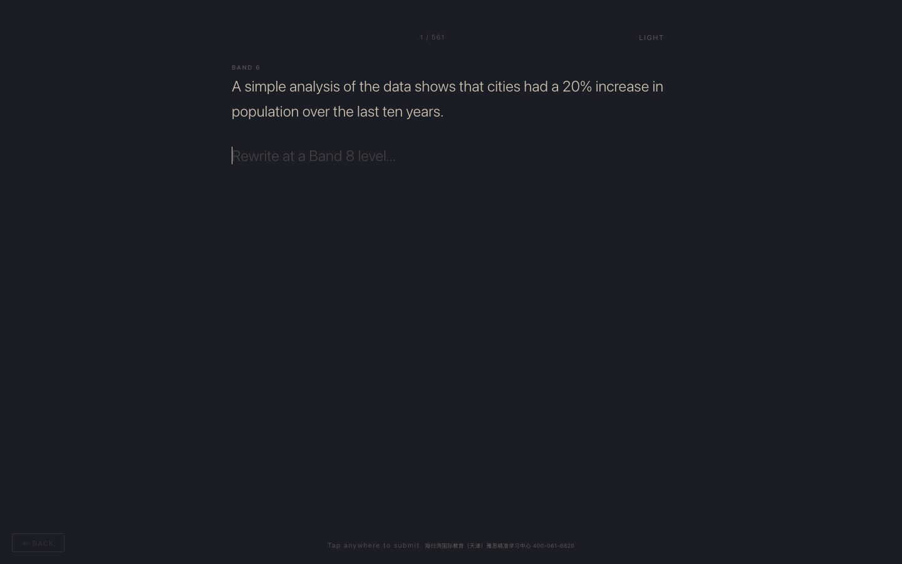
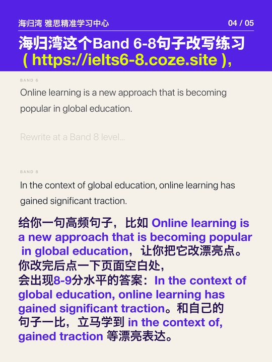
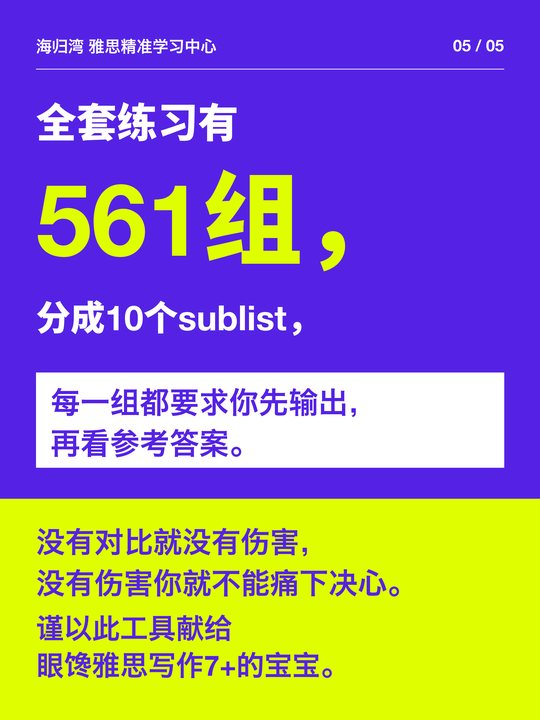

# IELTS Writing · Band 6 to Band 8 · 雅思写作 6 分升 8 分

Rewrite a Band 6 sentence at Band 8, then compare it with a Band 8 version.

把 6 分句子改写成 8 分，再和高分版本对照。

**Free · no sign-up · works on phones.** Part of [Free English Learning Tools](https://github.com/shelfom/free-english-learning-tools), 11 free websites for IELTS, Cambridge English and academic vocabulary.

**[▶ Open the site](https://tools.turtlebayedu.com/ielts-writing-band-6-to-8/)** (fastest in mainland China) · **[🌍 Global mirror](https://shelfom.github.io/ielts-writing-band-6-to-8/)** (GitHub Pages)

[](https://tools.turtlebayedu.com/ielts-writing-band-6-to-8/)

## What's inside

- 561 Band 6 sentences to upgrade
- Write your upgrade, then reveal a Band 8 rewrite
- A single HTML file: works offline once loaded

## How it works · 图解

Why this drill exists and how to use it, in five cards (Chinese).

<a href="docs/cards/01.jpg"></a> <a href="docs/cards/02.jpg"></a> <a href="docs/cards/03.jpg"></a> <a href="docs/cards/04.jpg"></a> <a href="docs/cards/05.jpg"></a>

## Run it locally

```bash
# No build step: open index.html in a browser
```

## More free tools from the same collection

| Site | What you practise | Open |
|---|---|---|
| [IELTS Listening Paraphrase](https://github.com/shelfom/ielts-listening-paraphrase) | Hear the words IELTS actually tests, then catch their paraphrases by ear. | [Site](https://tools.turtlebayedu.com/ielts-listening-paraphrase/) · [Mirror](https://shelfom.github.io/ielts-listening-paraphrase/) |
| [IELTS Reading Paraphrase](https://github.com/shelfom/ielts-reading-paraphrase) | Match the words in the question to the words in the passage — the core IELTS Reading skill. | [Site](https://tools.turtlebayedu.com/ielts-reading-paraphrase/) · [Mirror](https://shelfom.github.io/ielts-reading-paraphrase/) |
| [IELTS Sentence Repair](https://github.com/shelfom/ielts-sentence-repair) | Fix the grammar and word mistakes that cost IELTS writers their band score. | [Site](https://tools.turtlebayedu.com/ielts-sentence-repair/) · [Mirror](https://shelfom.github.io/ielts-sentence-repair/) |
| [IELTS Writing Translation · Write It Back](https://github.com/shelfom/ielts-writing-translation) | Translate model essays back from Chinese into English, sentence by sentence, and compare. | [Site](https://tools.turtlebayedu.com/ielts-writing-translation/) · [Mirror](https://shelfom.github.io/ielts-writing-translation/) |
| [IELTS Speaking Mock Test](https://github.com/shelfom/ielts-speaking-mock) | A full Part 1–3 speaking test with a British AI examiner and a four-criterion band report. | [Site](https://speaking.turtlebayedu.com/) |
| [IELTS Writing West](https://github.com/shelfom/ielts-writing-west) | Four AI coaches from *Journey to the West* diagnose your essay and guide your rewrite, one criterion at a time. | [Site](https://writing.turtlebayedu.com/) |
| [AWL 570 Flashcards](https://github.com/shelfom/awl-570-flashcards) | All 570 headwords of the Academic Word List — the vocabulary of IELTS, TOEFL and university reading. | [Site](https://tools.turtlebayedu.com/awl-570-flashcards/) · [Mirror](https://shelfom.github.io/awl-570-flashcards/) |
| [Cambridge KET Flashcards](https://github.com/shelfom/cambridge-ket-flashcards) | Every word on the official A2 Key vocabulary list, each with a storybook picture and a British voice. | [Site](https://tools.turtlebayedu.com/cambridge-ket-flashcards/) · [Mirror](https://shelfom.github.io/cambridge-ket-flashcards/) |
| [Cambridge PET Flashcards](https://github.com/shelfom/cambridge-pet-flashcards) | The B1 Preliminary words that KET doesn't cover, each with a picture, a voice and a simple example. | [Site](https://tools.turtlebayedu.com/cambridge-pet-flashcards/) · [Mirror](https://shelfom.github.io/cambridge-pet-flashcards/) |
| [Cambridge FCE Flashcards](https://github.com/shelfom/cambridge-fce-flashcards) | The B2 First words beyond KET and PET, unit by unit, with pictures and a British voice. | [Site](https://tools.turtlebayedu.com/cambridge-fce-flashcards/) · [Mirror](https://shelfom.github.io/cambridge-fce-flashcards/) |

Browse them all on one page: **https://shelfom.github.io/free-english-learning-tools/**

## Credits and license

Built by **Turtle Bay International Education (海归湾国际教育)**, an IELTS, TOEFL and Cambridge English school in Tianjin, China.

- Code: [MIT](LICENSE).
- Original learning content (illustrations, recordings, explanations, example sentences, model answers): free for non-commercial teaching and learning under [CC BY-NC 4.0](https://creativecommons.org/licenses/by-nc/4.0/).
- Unofficial practice material, not affiliated with or endorsed by Cambridge University Press & Assessment, the British Council or IDP. IELTS is their registered trademark. Rights holders can [open an issue](https://github.com/shelfom/ielts-writing-band-6-to-8/issues) and we will respond promptly.

If this helped you, please ⭐ star the repo so other learners can find it.
